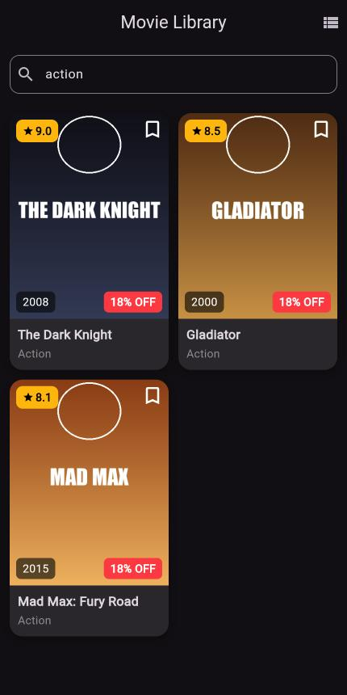

# Movie Library App — Section 3 (Mobile Development)

**Student:** Amr Ahmed El-Ghareeb

A Flutter app that shows a collection of movies with search and a list/grid toggle.

## Features
- `Movie` model with a `const` constructor + a list of 10 movies (`lib/movie.dart`)
- Local poster images in `assets/posters/`, shown with `Image.asset()`
- `MovieCard` (StatelessWidget): `Container` with rounded corners, shadow, theme color and `clipBehavior`; a `Stack` with a rating badge (top-left), bookmark icon (top-right) and year (bottom-left) using `Positioned`; title (bold) and genre (grey) below the image
- `HomePage` (StatefulWidget): `ListView.builder` / `GridView.builder` (2 columns) toggled from an `IconButton` in the AppBar
- Search **without a controller**: `onChanged` + `setState`, filtered with `.where().toList()`, matches title or genre, case-insensitive, shows **"No movies found"** when empty

## Bonus — One Tap, All Cards Change
Every card shows a shared **"20% OFF"** badge. The value is stored in `HomePage` (the parent) and passed to each `MovieCard` together with a `VoidCallback`.
Tapping the badge on any card calls the callback → `setState` in the parent → every card rebuilds and shows the new value (20% → 19% → 18% …). `MovieCard` stays stateless and no state-management package is used.

## Screenshots
| List view | Grid view + search ("action") |
|---|---|
|  |  |

## Run
```bash
flutter pub get
flutter run
```
